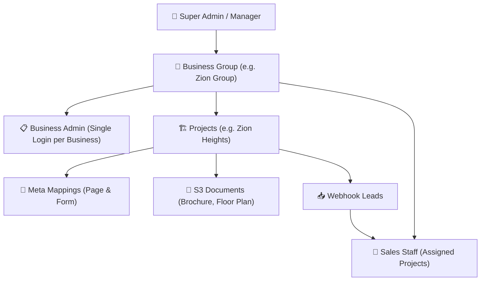
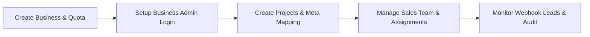
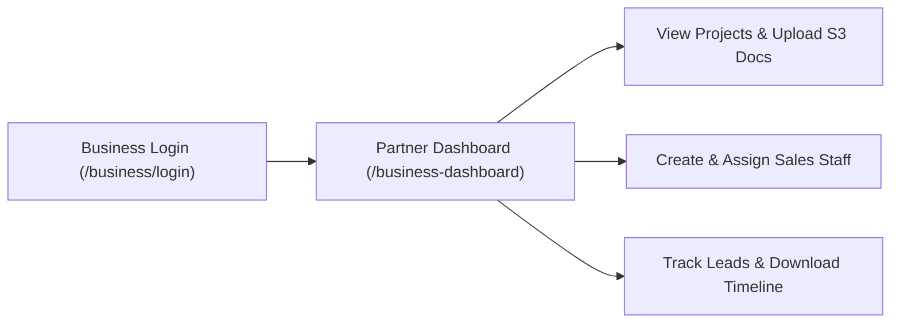
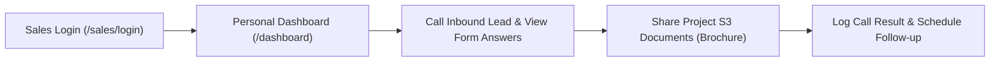
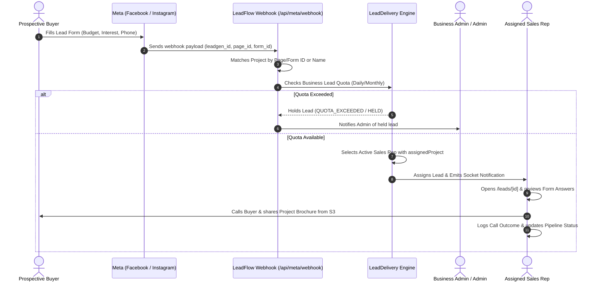

# LeadFlow CRM — Role-Based Flow & Permissions Specification

This document details the complete operational architecture, access boundaries, and end-to-end user journeys for the three core roles in **LeadFlow CRM**: **Admin**, **Business Admin**, and **Sales Staff**.

---

## 1. Architectural Hierarchy & Core Tenets

### Key System Tenets:
1. **Strict Hierarchy**: Businesses contain Projects. Projects contain Meta sources, Products, and S3 Documents. Sales staff belong to businesses and are assigned to specific projects.
2. **Business-Level Lead Limits Only**: 
   - Sales staff **do not** have daily capacity or lead limits. Any active salesperson assigned to a project can receive leads.
   - Lead limits (Daily, Monthly, or Unlimited) exist **only on the Business entity**, configured exclusively by Admin.
3. **Lead Allocation Privacy**:
   - Lead Quotas and Allocations are **strictly confidential to Admin**. Business Admins and Sales Staff cannot view or configure quotas.
4. **Project Governance**:
   - Only **Admin** can add, edit, or transition projects. Business Admin can view specifications and upload/download client documents.
   - Deletion of projects is disabled to protect historical CRM audit trails.
5. **Simplified Meta Mappings**:
   - Projects maintain **only 4 fields**: `Page Name`, `Page ID`, `Form Name`, and `Form ID`. No campaign, ad set, or ad ID clutter.

---

## 2. Role 1: Super Admin / Manager Flow

> [!NOTE]
> The Admin has unrestricted global access across all businesses, developer groups, projects, sales representatives, and lead transactions.

### What Admin Can Access & Manage:
| Area | Path | Admin Capabilities |
| :--- | :--- | :--- |
| **Businesses** | `/business` | - View all developer groups with project stats and active status. - Add new Business Groups with Name, Detail, Contact, and Lead Quotas. - Configure Business Lead Limits (`DAILY`, `MONTHLY`, `NONE`). - Create or reset the single Business Admin login account. - Edit business profile information. |
| **Business Details** | `/business/[id]` | - View business portfolio, project counts, and private lead quota. - Create projects under this business (`+ Add Project`). - Reset or change the business admin login password. |
| **Project Details** | `/business/projects/[id]` | - **Full Edit Rights**: Edit Project Name, Location, Stage (`UPCOMING`, `ONGOING`, `COMPLETED`), RERA registration, Unit inventory, and Meta Mappings. - Upload and delete S3 Documents (Brochures, Floor plans, Price sheets). - Change Project Stage with transition validations. |
| **Sales Team** | `/team` | - View all salespeople across all businesses with assigned projects. - Create new salesperson logins. - **Block / Unblock Staff**: Restrict staff from logging in or receiving leads. - **Assign Projects**: Multi-select modal to assign staff to specific projects. - Live search and top-10 pagination. |
| **Leads & Pipeline** | `/leads` & `/leads/[id]` | - View all leads across all businesses and projects. - Filter leads by Business, Project, Status, or Sales Rep. - View Meta Source Details card (Page Name, Form Name, IDs). - Assign unassigned leads to any active sales rep. - Manually change lead status, log calls, and schedule follow-ups. - **Download Transparency Timeline**: Export chronological event history. |
| **Delivery & Schedules**| `/dashboard` | - Configure lead release schedules and timezone hold windows. - Release held leads manually or automatically. - View funnel analytics (New, Interested, Follow-up, Won, Held). |
| **Meta Setup** | `/integration` | - Configure Meta Webhook URL, App Secret, and Verify Token. |
| **Audit Logs** | `/audit` | - System-wide audit trail for all business updates, password resets, and assignments. |

---

## 3. Role 2: Business Admin (Partner) Flow

> [!IMPORTANT]
> The Business Admin is the single authorized partner login for a specific developer entity (e.g. *Zion Group Admin*). Their visibility and management are strictly scoped to their own projects, staff, and leads.

### What Business Admin Can Access & Manage:
| Area | Path | Business Admin Capabilities |
| :--- | :--- | :--- |
| **Partner Dashboard** | `/business-dashboard` | - Multi-project dropdown filter (`ALL` or specific project). - Real-time sales pipeline counters (New Inbound, Interested, In Follow-up, Won). - Recent leads for their projects. - Follow-up schedule calendar preview. - Sales staff team summary. - Quick document upload modal. |
| **Business Overview** | `/business/[id]` | - Auto-redirects here when navigating to `/business`. - View business contact information and project breakdown. - Change their own account password. - Navigate into individual project details pages. |
| **Project Specifications** | `/business/projects/[id]` | - **Read-Only Project Specs**: View project name, location, stage, RERA number, and realistic price range product configurations. - View configured Meta mappings. - **Manage S3 Documents**: Upload and download brochures, price sheets, and floor plans for active projects. |
| **Sales Staff** | `/team` | - View only the sales representatives belonging to their business. - Create new sales staff accounts. - Assign their business projects to their staff. - View staff activity and assigned lead counts. |
| **Project Leads** | `/leads` & `/leads/[id]` | - View and filter leads strictly matching their business projects. - Inspect contact info, Meta source details, and unified form responses. - **Download Transparency Timeline**: Export complete event audit log. - Schedule follow-ups and log calls. |
| **Follow-ups & Calendar**| `/followups`, `/calendar` | - View upcoming and overdue client follow-ups across their projects. |

### Strict Boundaries for Business Admin:
- ❌ **Cannot See Lead Allocation**: Quota limits and remaining allocations are completely hidden.
- ❌ **Cannot Add Projects**: Projects must be created by Admin.
- ❌ **Cannot Edit Project Configurations**: Name, RERA, Stage, and Meta mappings can only be edited by Admin.
- ❌ **Cannot Access Other Businesses**: Strict database filtering prevents viewing other partners' projects, leads, or staff.

---

## 4. Role 3: Sales Staff / Salesperson Flow

> [!TIP]
> The Salesperson has a focused, execution-oriented workspace designed for fast client contact, call logging, and document sharing.

### What Sales Staff Can Access & Manage:
| Area | Path | Sales Staff Capabilities |
| :--- | :--- | :--- |
| **Personal Dashboard** | `/dashboard` | - Inbound leads assigned strictly to this salesperson. - Personal pipeline stats (New, Interested, Follow-ups, Won). - Overdue and upcoming follow-up reminders. |
| **Assigned Leads** | `/leads` | - Search and filter through their assigned leads. - View dynamic form responses (e.g., preferred budget, unit type interest). - One-click phone calling. |
| **Lead Details** | `/leads/[id]` | - View complete customer profile and contact details. - **Meta Source Details**: View Page Name, Form Name, and matched Project. - **Client Documents**: Open and share real project brochures, price sheets, and floor plans with the client. - **Status Updates**: Change status (`CONTACTED`, `INTERESTED`, `FOLLOW_UP`, `SCHEDULED`, `WON`, `LOST`, `NOT_INTERESTED`). - **Log Call**: Record call outcomes (`CONNECTED`, `NOT_PICKED`, `BUSY`, `WRONG_NUMBER`, `CALLBACK_REQUESTED`) with notes. - **Schedule Follow-up**: Add follow-up date, time, and reminders. - **Download Transparency Timeline**: Download the complete client audit log. |
| **Calendar & Follow-ups**| `/followups`, `/calendar` | - Calendar agenda and day/week view of scheduled client calls and site visits. |
| **Settings** | `/settings` | - Update personal profile information and change login password. |

### Strict Boundaries for Sales Staff:
- ❌ **No Lead Limit Restriction**: Can receive leads according to project assignment without artificial daily caps.
- ❌ **Cannot View Unassigned or Other Staff's Leads**: Database strictly restricts lead queries to `assignedTo: currentUser.id`.
- ❌ **Cannot Edit Project or Meta Settings**: Read-only access to documents and specs for assigned projects only.
- ❌ **Cannot Manage Users or Accounts**: No access to `/business`, `/team`, or configuration pages.

---

## 5. End-to-End Meta Lead Lifecycle

---

## 6. Role Comparison Matrix

| Feature / Capability | Super Admin | Business Admin | Sales Staff |
| :--- | :---: | :---: | :---: |
| **View Global Platform Metrics** | ✅ Full | ❌ Scoped | ❌ Personal |
| **Create & Configure Businesses** | ✅ Yes | ❌ No | ❌ No |
| **Configure Business Lead Quotas** | ✅ Yes | ❌ Hidden | ❌ Hidden |
| **Create Business Admin Login** | ✅ Yes | ❌ No | ❌ No |
| **Create Projects under Business** | ✅ Yes | ❌ No | ❌ No |
| **Edit Project Specs, RERA, Meta Mappings** | ✅ Yes | ❌ No | ❌ No |
| **Upload Project Documents to S3** | ✅ Yes | ✅ Yes | ❌ View Only |
| **Create Sales Staff Logins** | ✅ Yes | ✅ Own Team | ❌ No |
| **Block / Unblock Sales Staff** | ✅ Yes | ❌ No | ❌ No |
| **Assign Projects to Sales Staff** | ✅ Yes | ✅ Own Projects | ❌ No |
| **Sales Staff Daily Lead Limits** | ❌ Removed | ❌ Removed | ❌ Removed |
| **View Incoming Meta Leads** | ✅ All Leads | ✅ Business Projects | ✅ Assigned Only |
| **Download Transparency Timeline** | ✅ Yes | ✅ Yes | ✅ Yes |
| **Log Calls & Schedule Follow-ups** | ✅ Yes | ✅ Yes | ✅ Yes |
| **Meta Webhook Setup & Credentials** | ✅ Yes | ❌ No | ❌ No |
| **System Audit Logs** | ✅ Yes | ❌ No | ❌ No |
